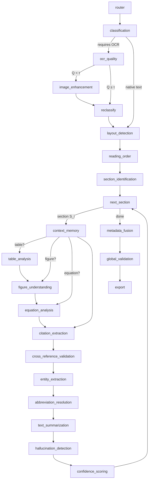

# Agentic GraphRAG — Stage 1: Document Extraction

Stage 1 of a three-stage Agentic GraphRAG system. It turns a PDF, DOCX or image
(PNG/JPG/JPEG/TIFF/BMP) into three files:

| File | Contents |
|---|---|
| `metadata.json` (M) | document info, per-section summary/keywords/confidence/object ids, statistics, quality |
| `document.json` (J) | full section text, tables, figures, equations (LaTeX), entities, abbreviations, cross-references, chunks, relationships |
| `validation_report.json` | Global Validation result: 5 weighted categories, every check with reasons, Q score, recommendations |

All three conform to the JSON Schemas in [`schemas/`](schemas), which Stage 2 validates
against.

Each of the 21 algorithms in the specification maps to one class
([TRACEABILITY_STAGE1.md](TRACEABILITY_STAGE1.md)). Ambiguities and engineering choices are
recorded in [DESIGN_DECISIONS.md](DESIGN_DECISIONS.md).

## Architecture

Algorithm 1 is a LangGraph `StateGraph` (`src/extraction/graph.py`) whose nodes map 1:1
to its lines, including the conditional edges:



(`reclassify` runs only for documents that had no text before OCR; see DESIGN_DECISIONS #8.
`AgenticDocumentExtractionFramework.mermaid()` prints the exact compiled graph.)

Every agent:

- is a `BaseAgent[InT, OutT]` with Pydantic v2 payloads (`src/extraction/schemas.py`);
- returns an `AgentResult`: output **or** a typed `AgentError`, never an exception;
- records a `TraceRecord` (agent, algorithm, latency, token usage, confidence);
- turns each "Validate …" block of its algorithm into named pass/fail `CheckResult`s with
  reasons;
- writes every "flag for manual review" path to the JSONL `ReviewQueue`, which never blocks
  the pipeline.

## Quick start

```bash
cd agentic_graphrag
python -m pip install -e ".[dev,llm]"     # Python 3.11+
cp .env.example .env                      # or reuse a .env in a parent directory
make test                                 # offline: MockLLM, FakeEmbedder, MockOCREngine
```

Run on a document. Providers come from `config.yaml`; keys come from `.env`:

```bash
python -m extraction path/to/document.pdf --config config.yaml --out output/mydoc
```

Run on generated sample documents, offline or live:

```bash
python examples/run_example.py
```

```bash
python examples/run_example.py --live
```

### Optional extras

| Extra | Enables |
|---|---|
| `pip install -e ".[embeddings]"` | `embedder.provider: sentence_transformers` (code default) |
| `pip install -e ".[ocr]"` + `sudo apt install tesseract-ocr` | real OCR for images and scanned PDFs (`ocr.engine: tesseract`) |
| `pip install -e ".[layout]"` | `layout.backend: docling` |

## Configuration

[`config.yaml`](config.yaml) is generated from the Pydantic models
(`scripts/generate_config.py`), so every value carries its description and default:

- every τ (classification, OCR quality, hallucination);
- every weight w_k (OCR quality metrics, confidence components, global validation categories);
- `ContextLimit`;
- retry and backoff limits.

It is validated on load: unknown keys, negative weights and inverted thresholds are
rejected.

| Provider setting | Code default | This repo's `config.yaml` |
|---|---|---|
| `llm.provider` | `anthropic` (`claude-opus-5-5`, structured outputs) | `azure_openai` (deployment from `$AZURE_OPENAI_DEPLOYMENT`) |
| `embedder.provider` | `sentence_transformers` (`all-MiniLM-L6-v2`) | `openrouter` (`liquid/lfm-2.5-embedding-350m:free`) |
| `ocr.engine` | `tesseract` | `tesseract` |

## Development

```bash
make test       # pytest, fully offline
```

```bash
make lint       # ruff + mypy --strict
```

```bash
make schemas    # regenerate schemas/ from output_models.py (a test catches drift)
```

## Layout

```
src/common/        base_agent, llm, embedder, config, logging, review_queue, validation, text
src/extraction/    agents/ (20 agents), graph.py (Alg. 1), schemas.py, output_models.py,
                   parsers.py, layout_models.py, image_ops.py, ocr.py, testing.py, cli.py
schemas/           document / metadata / validation_report JSON Schemas (Stage 2 contract)
tests/             common/ and extraction/ (unit per agent, graph routing, integration)
examples/          run_example.py
```

## Known limitations

- **Default layout detection is heuristic** (geometry + fonts + patterns). It handles
  single, double and multi-column pages, headers, footers, captions, equations, lists and
  references well on typical documents. Complex magazine layouts will do better with the
  docling backend.
- **Scanned tables are recovered from column gaps.** Ruled-line detection on images is
  not implemented.
- **Real OCR needs the Tesseract binary**, which is not installed on this machine.
- **Free OpenRouter models are rate-limited** to 20 requests per minute. The embedder
  waits and retries, so live runs on large documents are slow on the free tier.
