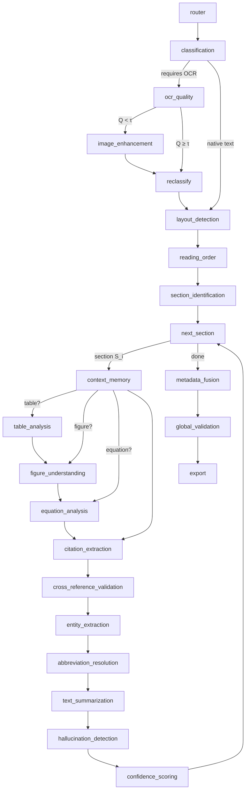
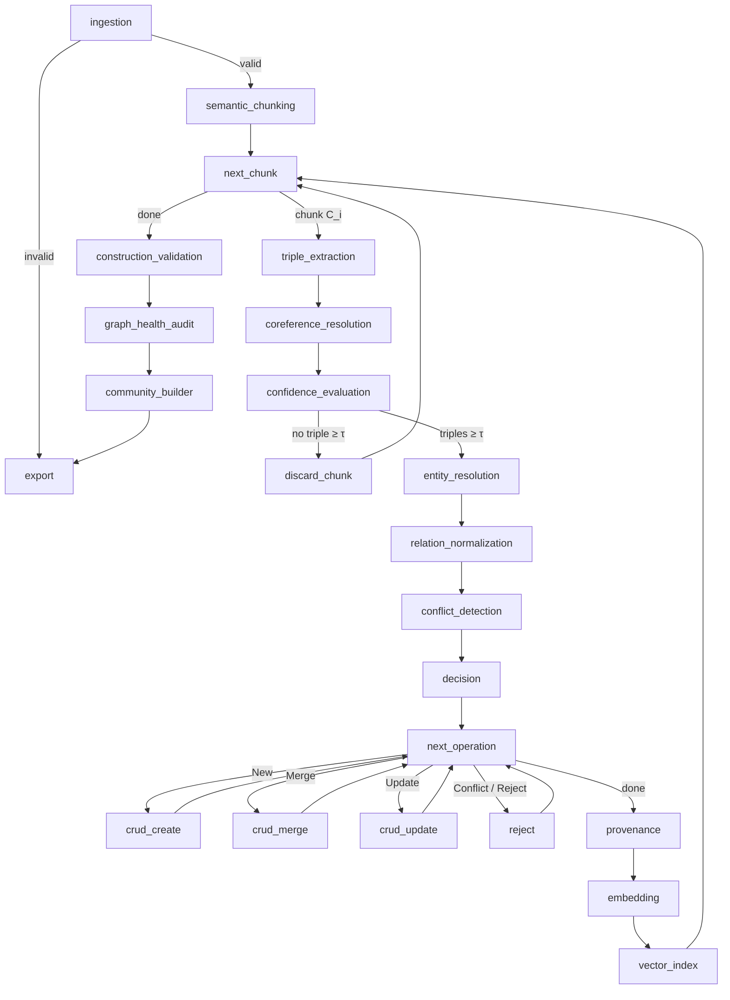
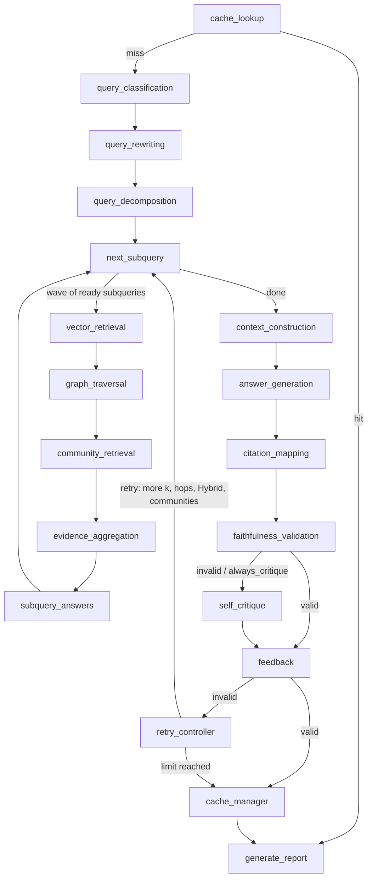

# Agentic GraphRAG — Stage 1: Document Extraction · Stage 2: Graph Construction · Stage 3: Retrieval

> Stage 2 (knowledge-graph construction) is documented in
> [Stage 2: Graph Construction](#stage-2-graph-construction) and Stage 3 (agentic graph
> retrieval and answering) in [Stage 3: Retrieval and Answering](#stage-3-retrieval-and-answering)
> below. [TRACEABILITY.md](TRACEABILITY.md) maps every algorithm of all three stages to its class.

Stage 1 of a three-stage Agentic GraphRAG system. It turns a PDF, DOCX or image
(PNG/JPG/JPEG/TIFF/BMP) into three files:

| File | Contents |
|---|---|
| `metadata.json` (M) | document info, per-section summary/keywords/confidence/object ids, statistics, quality |
| `document.json` (J) | full section text, tables, figures, equations (LaTeX), entities, abbreviations, cross-references, chunks, relationships |
| `validation_report.json` | Global Validation result: 5 weighted categories, every check with reasons, Q score, recommendations |

All three conform to the JSON Schemas in [`schemas/`](schemas), which Stage 2 validates
against.

Each of the 21 algorithms in the specification maps to one class
([TRACEABILITY_STAGE1.md](TRACEABILITY_STAGE1.md)). Ambiguities and engineering choices are
recorded in [DESIGN_DECISIONS.md](DESIGN_DECISIONS.md).

## Architecture

Algorithm 1 is a LangGraph `StateGraph` (`src/extraction/graph.py`) whose nodes map 1:1
to its lines, including the conditional edges:



(`reclassify` runs only for documents that had no text before OCR; see DESIGN_DECISIONS #8.
`AgenticDocumentExtractionFramework.mermaid()` prints the exact compiled graph.)

Every agent:

- is a `BaseAgent[InT, OutT]` with Pydantic v2 payloads (`src/extraction/schemas.py`);
- returns an `AgentResult`: output **or** a typed `AgentError`, never an exception;
- records a `TraceRecord` (agent, algorithm, latency, token usage, confidence);
- turns each "Validate …" block of its algorithm into named pass/fail `CheckResult`s with
  reasons;
- writes every "flag for manual review" path to the JSONL `ReviewQueue`, which never blocks
  the pipeline.

## Quick start

```bash
cd agentic_graphrag
python -m pip install -e ".[dev,llm]"     # Python 3.11+
cp .env.example .env                      # or reuse a .env in a parent directory
make test                                 # offline: MockLLM, FakeEmbedder, MockOCREngine
```

Run on a document. Providers come from `config.yaml`; keys come from `.env`:

```bash
python -m extraction path/to/document.pdf --config config.yaml --out output/mydoc
```

Run on generated sample documents, offline or live:

```bash
python examples/run_example.py
```

```bash
python examples/run_example.py --live
```

### Optional extras

| Extra | Enables |
|---|---|
| `pip install -e ".[embeddings]"` | `embedder.provider: sentence_transformers` (code default) |
| `pip install -e ".[ocr]"` + `sudo apt install tesseract-ocr` | real OCR for images and scanned PDFs (`ocr.engine: tesseract`) |
| `pip install -e ".[layout]"` | `layout.backend: docling` |
| `pip install -e ".[api]"` | Stage 3 FastAPI service (`graphrag serve`) and its tests |

## Configuration

[`config.yaml`](config.yaml) is generated from the Pydantic models
(`scripts/generate_config.py`), so every value carries its description and default:

- every τ (classification, OCR quality, hallucination);
- every weight w_k (OCR quality metrics, confidence components, global validation categories);
- `ContextLimit`;
- retry and backoff limits.

It is validated on load: unknown keys, negative weights and inverted thresholds are
rejected.

| Provider setting | Code default | This repo's `config.yaml` |
|---|---|---|
| `llm.provider` | `anthropic` (`claude-opus-5-5`, structured outputs) | `azure_openai` (deployment from `$AZURE_OPENAI_DEPLOYMENT`) |
| `embedder.provider` | `sentence_transformers` (`all-MiniLM-L6-v2`) | `openrouter` (`liquid/lfm-2.5-embedding-350m:free`) |
| `ocr.engine` | `tesseract` | `tesseract` |

## Stage 2: Graph Construction

Stage 2 reads Stage 1's `document.json` (J) and `metadata.json` (M) and updates a knowledge
graph (KG) and a vector database (VDB). It then writes `construction_report.json`. The
15 agents A1–A15 of *Construction.pdf* map one class each
([TRACEABILITY_STAGE2.md](TRACEABILITY_STAGE2.md)), with ambiguities recorded under
"Stage 2" in [DESIGN_DECISIONS.md](DESIGN_DECISIONS.md). Stage 2 reuses Stage 1's
`BaseAgent`, `LLMClient`, `Embedder`, `ReviewQueue`, JSON Schemas and abbreviation
repository.



Any per-chunk node that fails marks that chunk `failed`, flags it for review and moves
on to the next chunk. `AgenticGraphConstructionFramework.mermaid()` prints the compiled
graph.

```bash
construct --json document.json --metadata metadata.json            # providers from construction.yaml
```

```bash
construct --json document.json --metadata metadata.json --offline  # MockLLM + FakeEmbedder
```

```bash
make construct-example                                             # Stage 1 → Stage 2 on a sample PDF
```

With the default in-memory backends, the KG and VDB persist to `paths.state_dir`
(`output/kg_state`), so successive runs are incremental. Re-ingesting a document only
produces Update operations: no duplicate nodes, edges or vectors.

### Backends

| Interface | Test / default backend | Production backend |
|---|---|---|
| `GraphStore` | `InMemoryGraphStore` (networkx) | `Neo4jGraphStore` (native vector indexes) |
| `VectorStore` | `InMemoryVectorStore` | `QdrantVectorStore` |

```bash
pip install -e ".[graph]" && docker compose up -d
```

```bash
NEO4J_PASSWORD=graphrag-dev construct --json document.json --metadata metadata.json --graph-backend neo4j --vector-backend qdrant
```

```bash
GRAPHRAG_LIVE_STORES=1 NEO4J_PASSWORD=graphrag-dev make test      # also runs the store contract on Neo4j + Qdrant
```

### Ontology and configuration

- [`ontology.yaml`](ontology.yaml) is the ontology O. It defines 17 entity types with
  synonyms and 22 predicates, each with synonyms, inverse synonyms, domain/range, and
  `functional` flags. It also lists exclusive predicate pairs. The file is validated at
  startup.
- [`construction.yaml`](construction.yaml) holds τ (confidence), δ (entity similarity),
  chunk sizes and overlap, the audit thresholds, community settings and backends.

### Outputs

`construction_report.json` contains:

- chunk outcomes: accepted, skipped below τ, or failed, with stage and error;
- triple counts and the New/Merge/Update/Conflict/Reject statuses;
- Create/Merge/Update/Reject operations;
- every `ConflictRecord`;
- the A14 checks;
- A15 audit metrics: orphans, duplicates, stale and low-confidence edges, components,
  provenance and vector coverage, and `health_score`;
- the community summary, per-agent traces, and export paths: `knowledge_graph.json` and
  `vector_database.json`.

## Stage 3: Retrieval and Answering

Stage 3 answers a question Q (optionally with conversation history) over the Stage 2 KG
and VDB. It returns a grounded answer **A**, citations **C** (every statement mapped to
chunk, node and edge ids, page and document), and a validation report **R**. The 15 agents
of *Retrieval.pdf* map one class each
([TRACEABILITY_STAGE3.md](TRACEABILITY_STAGE3.md)). Ambiguities are resolved in
[DESIGN_DECISIONS.md](DESIGN_DECISIONS.md#design-decisions-stage-3-graph-retrieval-and-answering).

Algorithm 1 is a LangGraph `StateGraph` (`src/retrieval/graph.py`):



- **A1** classifies Local / Global / Hybrid / Simple Lookup. Hybrid is evaluated first,
  which the PDF's ordering made unreachable.
- **A2** resolves references from history, expands acronyms and fixes spelling against
  the KG vocabulary.
- **A3** splits complex questions into ordered subqueries. Dependencies use `{qN}`
  placeholders that are filled with the earlier subquery's answer; independent
  subqueries run in parallel.
- **A4–A7** retrieve the top-k chunks and entities, traverse multi-hop paths, and rank
  community summaries, weighted heavily for Global and lightly for Local queries. They
  then merge, de-duplicate and rank all evidence by relevance × graph confidence.
- **A8–A10** build a token-budgeted context of citable blocks `[E#]`, generate an answer
  that cites them (or says "insufficient evidence"), and map every statement to its
  chunk, node and edge ids, page and document.
- **A11** checks every claim against its evidence and every citation id against the
  stores. Valid ⇔ faithfulness score ≥ τ, all citations resolve, and the evidence is
  sufficient.
- **A12–A14** run on failure: an independent critique, bounded confidence feedback on the
  implicated graph elements (with review flags), and a retry with escalated parameters,
  up to `retry.max_retries`. If every attempt fails, the best attempt is returned with
  `verified: false` and `low_confidence: true`.
- **A15** is a semantic cache keyed by query embedding and conversation history. Only
  verified answers are stored, and entries are invalidated when feedback or Stage 2
  changes a cited element.

### Usage

```bash
make run-example
```

That runs Stage 1 → 2 → 3 offline on the generated sample PDF, and fails unless every
answer is verified with resolvable citations. Against a KG built by `construct`:

```bash
graphrag query "What is the inspection interval of the HCU?" --offline
```

```bash
graphrag report rpt-<id>
```

```bash
graphrag serve
```

`graphrag serve` exposes `POST /query` (`{"query": "...", "history": [{"role": "user",
"content": "..."}]}`) and `GET /report/{id}`. Without `--offline`, providers come from
`retrieval.yaml` (Azure OpenAI chat + OpenRouter embeddings, as in Stages 1–2). The query
embedder must be the one the KG was built with.

### Outputs

`<paths.output_dir>/reports/<report_id>.json` (R) holds:

- the answer, `verified` and `low_confidence`, the citations, and the
  **citation-integrity proof** (one store lookup per cited id);
- the classification, the rewritten query, the subqueries with waves and intermediate
  answers, and the evidence per subquery;
- the context blocks and the validation (claims, checks, score, τ);
- every attempt (parameters, escalation, score, critique, feedback) and the retry
  decisions;
- cache lookup, store and invalidations;
- the per-call agent trace (latency, tokens, score) and a per-agent summary.

The cache and the feedback log sit next to the reports.

## Development

```bash
make test       # pytest, fully offline
```

```bash
make lint       # ruff + mypy --strict
```

```bash
make schemas    # regenerate schemas/ from output_models.py (a test catches drift)
```

## Layout

```
src/common/        base_agent, llm, embedder, config, logging, review_queue, validation, text
src/extraction/    agents/ (20 agents), graph.py (Alg. 1), schemas.py, output_models.py,
                   parsers.py, layout_models.py, image_ops.py, ocr.py, testing.py, cli.py
src/construction/  agents/ (A1-A15), graph.py (Stage 2 Alg. 1), community.py, ontology.py,
                   stores/ (memory, neo4j, qdrant), models.py, config.py, testing.py, cli.py
src/retrieval/     agents/ (A1-A15), graph.py (Stage 3 Alg. 1), models.py, config.py, text.py,
                   api.py (FastAPI), cli.py + run_all.py (graphrag), testing.py
schemas/           document / metadata / validation_report JSON Schemas (Stage 2 contract)
tests/             common/, extraction/, construction/ and retrieval/ (unit per agent, graph routing, integration)
examples/          run_example.py, run_construction_example.py
ontology.yaml      Stage 2 ontology O;  construction.yaml / retrieval.yaml: Stage 2 / 3 config;  docker-compose.yml: Neo4j + Qdrant
```

## Known limitations

- **Default layout detection is heuristic** (geometry + fonts + patterns). It handles
  single, double and multi-column pages, headers, footers, captions, equations, lists and
  references well on typical documents. Complex magazine layouts will do better with the
  docling backend.
- **Scanned tables are recovered from column gaps.** Ruled-line detection on images is
  not implemented.
- **Real OCR needs the Tesseract binary**, which is not installed on this machine.
- **Free OpenRouter models are rate-limited** to 20 requests per minute. The embedder
  waits and retries, so live runs on large documents are slow on the free tier.
- **Stage 2's offline triple extractor is a pattern matcher** used only by tests and
  `--offline`. Real extraction quality depends on the configured LLM.
- **A chunk that fails after Graph CRUD** (in A11–A13) keeps its edges without full
  provenance or vectors. Construction Validation reports it, but nothing is rolled back
  (DESIGN_DECISIONS Stage 2 #16).
- **Stage 3's offline answer generator is extractive.** It copies the best-matching
  context sentence per subquestion. It drives every branch deterministically; real
  answer quality comes from the configured LLM.
- **Retrieval feedback lives in the KG.** A later Stage 2 Merge/Update recomputes an
  edge's confidence from provenance, which overrides earlier feedback on that edge.
