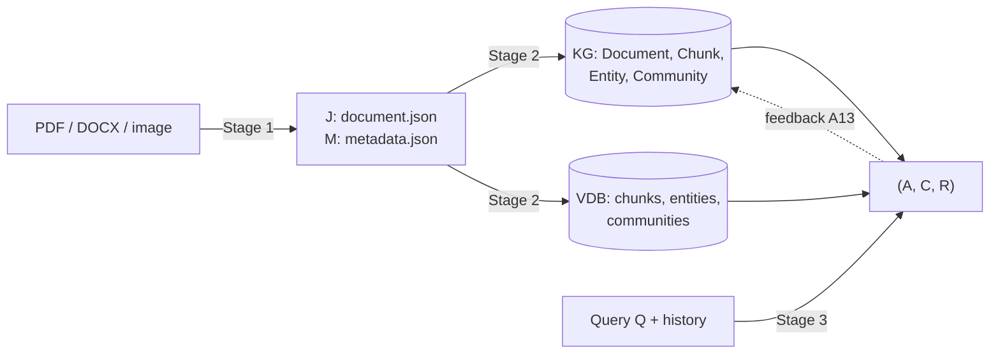

# Traceability: Agentic GraphRAG, all three stages

Every algorithm in the three specification PDFs maps to exactly one class. This page
combines the three per-stage matrices into one map and shows how data flows between the
stages. Test ids and validation checks live in the per-stage files, and each has a test
that parses its table and fails if a class, file or test it names does not exist:

| Stage | Spec | Matrix | Code | Tests | Matrix test |
|---|---|---|---|---|---|
| 1 Document extraction | *Agentic Document Extraction Framework* (Alg. 1–21) | [TRACEABILITY_STAGE1.md](TRACEABILITY_STAGE1.md) | `src/extraction/` | `tests/extraction/` | `tests/extraction/test_traceability.py` |
| 2 Graph construction | *Construction.pdf* (Alg. 1–16, A1–A15) | [TRACEABILITY_STAGE2.md](TRACEABILITY_STAGE2.md) | `src/construction/` | `tests/construction/` | `tests/construction/test_traceability.py` |
| 3 Retrieval and answering | *Retrieval.pdf* (Alg. 1–16, A1–A15) | [TRACEABILITY_STAGE3.md](TRACEABILITY_STAGE3.md) | `src/retrieval/` | `tests/retrieval/` | `tests/retrieval/test_traceability.py` |

`tests/retrieval/test_traceability.py::test_combined_traceability_lists_every_stage_class`
checks that every class in the three stage matrices also appears below.

## Data flow

| Contract | Producer | Consumer | Enforced by |
|---|---|---|---|
| J, M (JSON Schema `schemas/*.schema.json`, v1.0.0) | Stage 1 `MetadataFusionAgent` | Stage 2 `DocumentIngestionAgent` | schema validation in both; `test_published_schemas_match_models` |
| Chunk/Entity/Community nodes, ontology edges, provenance | Stage 2 A10–A13 + `CommunityBuilder` | Stage 3 A4–A8, A10, A11 | `ConstructionValidationAgent`; Stage 3 citation-integrity check |
| `retrieval_confidence`, edge confidence, review items | Stage 3 `FeedbackAgent` | Stage 3 A7 ranking; human review queue | `test_feedback_confidence_lowers_fact_ranking` |
| Cache fingerprints of cited elements | Stage 3 `CacheManagerAgent` | Stage 3 lookups after Stage 2 re-runs | `test_invalidation_by_element_and_on_graph_change`, `test_purge_stale_after_construction` |
| End-to-end chain | `graphrag run-all` / `make run-example` | — | `test_run_all_chains_three_stages` |

## Stage 1: document extraction

| Alg | Algorithm | Class | File |
|---|---|---|---|
| 1 | Overall Agentic Document Extraction Framework | `AgenticDocumentExtractionFramework` | `src/extraction/graph.py` |
| 2 | Router Agent | `RouterAgent` | `src/extraction/agents/router.py` |
| 3 | Document Classification Agent | `DocumentClassificationAgent` | `src/extraction/agents/classification.py` |
| 4 | OCR Quality Assessment Agent | `OCRQualityAssessmentAgent` | `src/extraction/agents/ocr_quality.py` |
| 5 | Image Enhancement Agent | `ImageEnhancementAgent` | `src/extraction/agents/image_enhancement.py` |
| 6 | Layout Detection Agent | `LayoutDetectionAgent` | `src/extraction/agents/layout.py` |
| 7 | Reading Order Agent | `ReadingOrderAgent` | `src/extraction/agents/reading_order.py` |
| 8 | Section Identification Agent | `SectionIdentificationAgent` | `src/extraction/agents/section_identification.py` |
| 9 | Context Memory Agent | `ContextMemoryAgent` | `src/extraction/agents/context_memory.py` |
| 10 | Table Analysis Agent | `TableAnalysisAgent` | `src/extraction/agents/table_analysis.py` |
| 11 | Figure Understanding Agent | `FigureUnderstandingAgent` | `src/extraction/agents/figure_understanding.py` |
| 12 | Equation Analysis Agent | `EquationAnalysisAgent` | `src/extraction/agents/equation_analysis.py` |
| 13 | Internal Citation Extraction Agent | `InternalCitationExtractionAgent` | `src/extraction/agents/citation_extraction.py` |
| 14 | Cross-Reference Validation Agent | `CrossReferenceValidationAgent` | `src/extraction/agents/cross_reference.py` |
| 15 | Entity Extraction Agent | `EntityExtractionAgent` | `src/extraction/agents/entity_extraction.py` |
| 16 | Abbreviation Resolution Agent | `AbbreviationResolutionAgent` | `src/extraction/agents/abbreviation.py` |
| 17 | Text Summarization Agent | `TextSummarizationAgent` | `src/extraction/agents/summarization.py` |
| 18 | Hallucination Detection Agent | `HallucinationDetectionAgent` | `src/extraction/agents/hallucination.py` |
| 19 | Confidence Scoring Agent | `ConfidenceScoringAgent` | `src/extraction/agents/confidence.py` |
| 20 | Metadata Fusion & JSON Appending Agent | `MetadataFusionAgent` | `src/extraction/agents/metadata_fusion.py` |
| 21 | Global Validation Agent | `GlobalValidationAgent` | `src/extraction/agents/global_validation.py` |

## Stage 2: graph construction

| Agent | Alg | Agent (PDF) | Class | File |
|---|---|---|---|---|
| — | 1 | Overall Agentic Graph Construction Framework | `AgenticGraphConstructionFramework` | `src/construction/graph.py` |
| A1 | 2 | Document Ingestion Agent | `DocumentIngestionAgent` | `src/construction/agents/ingestion.py` |
| A2 | 3 | Semantic Chunking Agent | `SemanticChunkingAgent` | `src/construction/agents/chunking.py` |
| A3 | 4 | Triple Extraction Agent | `TripleExtractionAgent` | `src/construction/agents/triple_extraction.py` |
| A4 | 5 | Coreference Resolution Agent | `CoreferenceResolutionAgent` | `src/construction/agents/coreference.py` |
| A5 | 6 | Confidence Evaluation Agent | `ConfidenceEvaluationAgent` | `src/construction/agents/confidence_evaluation.py` |
| A6 | 7 | Entity Resolution Agent | `EntityResolutionAgent` | `src/construction/agents/entity_resolution.py` |
| A7 | 8 | Relation Normalization Agent | `RelationNormalizationAgent` | `src/construction/agents/relation_normalization.py` |
| A8 | 9 | Conflict Detection Agent | `ConflictDetectionAgent` | `src/construction/agents/conflict_detection.py` |
| A9 | 10 | Decision Agent | `DecisionAgent` | `src/construction/agents/decision.py` |
| A10 | 11 | Graph CRUD Agent | `GraphCRUDAgent` | `src/construction/agents/graph_crud.py` |
| A11 | 12 | Provenance Agent | `ProvenanceAgent` | `src/construction/agents/provenance.py` |
| A12 | 13 | Embedding Agent | `EmbeddingAgent` | `src/construction/agents/embedding.py` |
| A13 | 14 | Vector Index Agent | `VectorIndexAgent` | `src/construction/agents/vector_index.py` |
| A14 | 15 | Construction Validation Agent | `ConstructionValidationAgent` | `src/construction/agents/construction_validation.py` |
| A15 | 16 | Graph Health Audit Agent | `GraphHealthAuditAgent` | `src/construction/agents/health_audit.py` |
| CB | — | Community summaries (post-step, feeds Stage 3 A6) | `CommunityBuilder` | `src/construction/community.py` |

## Stage 3: graph retrieval and answering

| Agent | Alg | Agent (PDF) | Class | File |
|---|---|---|---|---|
| — | 1 | Overall Agentic Graph Retrieval Framework | `AgenticGraphRetrievalFramework` | `src/retrieval/graph.py` |
| A1 | 2 | Query Classification Agent | `QueryClassificationAgent` | `src/retrieval/agents/query_classification.py` |
| A2 | 3 | Query Rewriting Agent | `QueryRewritingAgent` | `src/retrieval/agents/query_rewriting.py` |
| A3 | 4 | Query Decomposition Agent | `QueryDecompositionAgent` | `src/retrieval/agents/query_decomposition.py` |
| A4 | 5 | Vector Retrieval Agent | `VectorRetrievalAgent` | `src/retrieval/agents/vector_retrieval.py` |
| A5 | 6 | Graph Traversal Agent | `GraphTraversalAgent` | `src/retrieval/agents/graph_traversal.py` |
| A6 | 7 | Community Retrieval Agent | `CommunityRetrievalAgent` | `src/retrieval/agents/community_retrieval.py` |
| A7 | 8 | Evidence Aggregation Agent | `EvidenceAggregationAgent` | `src/retrieval/agents/evidence_aggregation.py` |
| A8 | 9 | Context Construction Agent | `ContextConstructionAgent` | `src/retrieval/agents/context_construction.py` |
| A9 | 10 | Answer Generation Agent | `AnswerGenerationAgent` | `src/retrieval/agents/answer_generation.py` |
| A10 | 11 | Citation Mapping Agent | `CitationMappingAgent` | `src/retrieval/agents/citation_mapping.py` |
| A11 | 12 | Faithfulness Validation Agent | `FaithfulnessValidationAgent` | `src/retrieval/agents/faithfulness_validation.py` |
| A12 | 13 | Self-Critique Agent | `SelfCritiqueAgent` | `src/retrieval/agents/self_critique.py` |
| A13 | 14 | Feedback Agent | `FeedbackAgent` | `src/retrieval/agents/feedback.py` |
| A14 | 15 | Retry Controller Agent | `RetryControllerAgent` | `src/retrieval/agents/retry_controller.py` |
| A15 | 16 | Cache Manager Agent | `CacheManagerAgent` | `src/retrieval/agents/cache_manager.py` |

## Shared foundation (all stages)

| Component | File |
|---|---|
| `BaseAgent`, `AgentResult`, `TraceRecord`, `TraceSink` | `src/common/base_agent.py` |
| `LLMClient` (Anthropic, Azure OpenAI, OpenRouter, `MockLLM`) | `src/common/llm.py` |
| `Embedder` (sentence-transformers, OpenAI-compatible, `FakeEmbedder`) | `src/common/embedder.py` |
| `ReviewQueue` (JSONL) | `src/common/review_queue.py` |
| `CheckResult`, `ValidationOutcome` | `src/common/validation.py` |
| `GraphStore` / `VectorStore` (memory, Neo4j, Qdrant) | `src/construction/stores/` |
